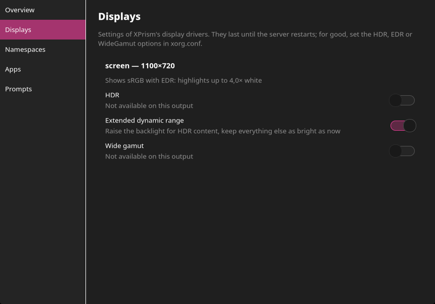
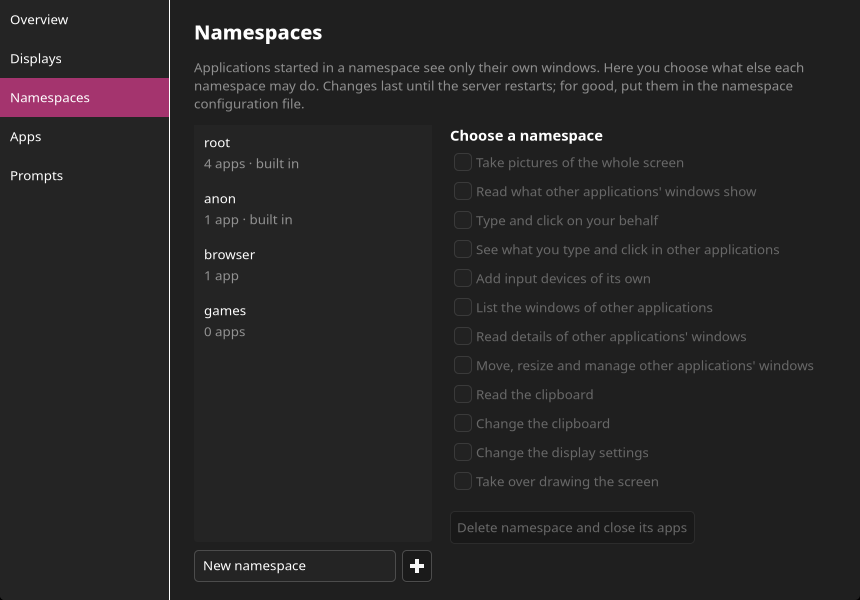

# XPrism Control

Settings for the [XPrism](https://github.com/XPrismOrg/xserver) X server,
in a window and in the terminal:

- **xprism-control-panel**, a small GTK 4 application
- **xprismctl**, the same from the command line

Both are plain C on top of one small library (`lib/xpctl.c`, about 800
lines) that speaks to the server with xcb. They change the server while
it runs; nothing is stored. To keep a setting, put it in `xorg.conf` or the
namespace configuration file.

| Displays | Namespaces |
|---|---|
|  |  |

## What it controls

| | Control panel | xprismctl |
|---|---|---|
| HDR, EDR and wide gamut per output | Displays | `displays`, `display OUTPUT edr on` |
| Namespaces: create, delete, permissions | Namespaces | `namespaces`, `namespace create`, `grant`, `revoke` |
| Connected applications and what they may do | Apps | `apps` |
| Permission prompts from confined applications | Prompts | `agent` |
| Server version and features | Overview | `status` |

Namespaces, apps and prompts use XPrism's X-NAMESPACE extension, which only
the session's own clients can reach (those with the session's
`$XAUTHORITY`). Applications in a sandbox cannot change their own
permissions.

## Examples

```sh
$ xprismctl status
server       XPrism 26.11.01
compositor   built in (XPRISM-SCENE)
colour       managed (XPRISM-COLOR)
namespaces   on (X-NAMESPACE 1.2)

$ xprismctl display eDP-1 edr on
eDP-1: edr on

$ xprismctl namespace create browser clipboard.read clipboard.write
created browser
$ xprismctl revoke browser clipboard.read
browser may: clipboard.write

$ xprismctl apps
CLIENT     NAMESPACE        APP                      PID      MAY ALSO
0x600000   browser          firefox                  4242     clipboard.write

$ xprismctl agent
Answering permission prompts. Ctrl+C stops.

firefox (namespace browser, pid 4242) wants to take pictures of the whole screen.
[a]llow once, allow [w]hile it runs, [d]eny, deny [f]orever? d
denied
```

`xprismctl caps` lists all permissions; `man xprismctl` has the rest.

## Building

Needs meson, libxcb (with randr and res) and, for the window, GTK 4.

```sh
meson setup build        # -Dgui=disabled for xprismctl alone
ninja -C build
sudo ninja -C build install
```

On NixOS, `nix-shell` gives everything.

## Tests

`meson test -C build` starts XPrism's Xvfb with a namespace configuration
and runs xprismctl against it, including a real permission prompt, then
checks that the control panel starts. It looks for Xvfb at
`../xserver/build/hw/vfb/Xvfb` (set `XPRISM_XVFB` for another one) and skips
without it.

## License

MIT, see [LICENSE](LICENSE).
